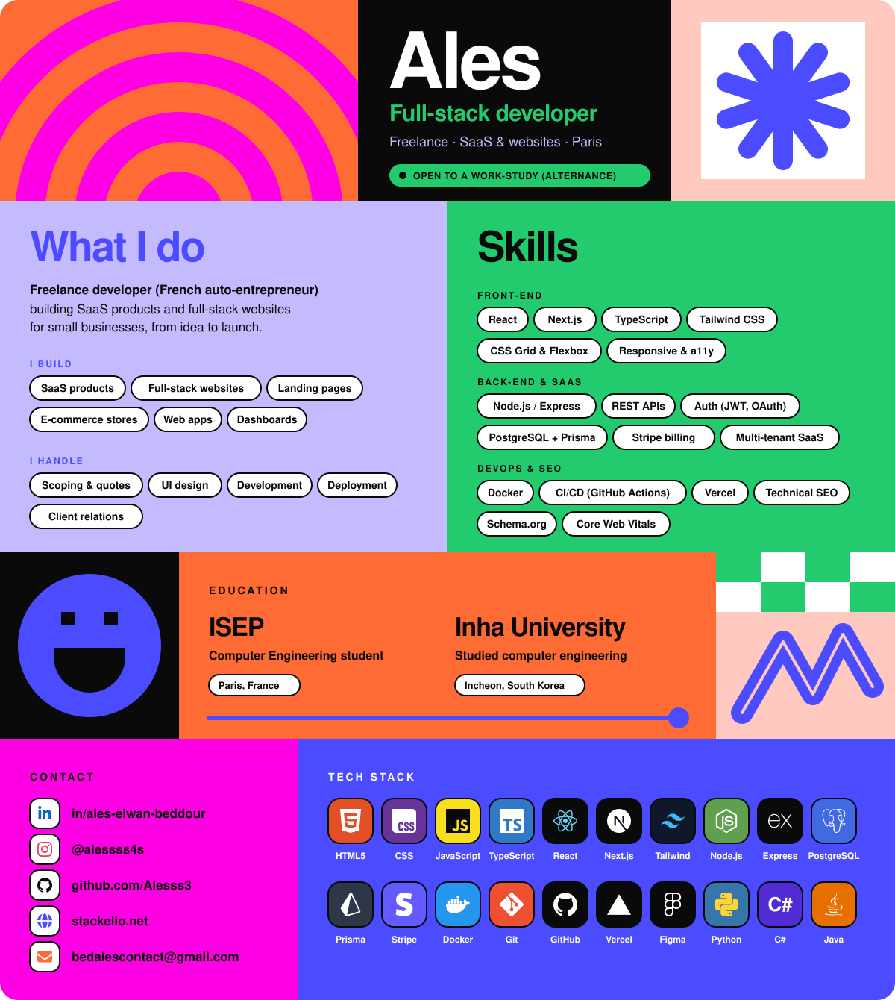

  

# Hi, I'm Ales 👋

**Full-stack developer and freelancer (French *auto-entrepreneur*)** based in Paris.
I build **SaaS products** and **full-stack websites** for small businesses, from the first idea to launch.

> 🔎 **I'm looking for a work-study position (alternance)** as a full-stack / software engineer. Feel free to reach out!

- 🎓 Computer Engineering student at **ISEP** (Paris)
- 🇰🇷 Previously studied at **Inha University** (Incheon, South Korea)
- 💼 Running my own web studio: [stackelio.net](https://stackelio.net)

## What I do

- **SaaS products**: multi-tenant web apps, dashboards, subscriptions and internal tools
- **Full-stack websites**: landing pages, business sites and online stores
- **End to end**: scoping, UI design, development, SEO and deployment

## Skills

| Area | Skills |
|---|---|
| Languages | JavaScript, TypeScript, Python, C#, Java |
| Front-end | React, Next.js, TypeScript, Tailwind CSS, CSS Grid & Flexbox, responsive design, accessibility |
| Back-end & SaaS | Node.js / Express, REST APIs, authentication (JWT, OAuth), PostgreSQL + Prisma, Stripe billing, multi-tenant architecture |
| DevOps | Docker, CI/CD with GitHub Actions, Vercel, Git |
| SEO | Technical SEO, local SEO, Schema.org, Open Graph, Core Web Vitals |
| Client work | Scoping and quotes, UI design in Figma, client relations, fast delivery |

## Tech stack

## Contact

